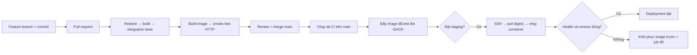

# Học CI/CD thực tế với .NET và Docker

Đây là phòng lab cho dev .NET bắt đầu học CI/CD: một Task API nhỏ, test tự động, Docker image, GitHub Actions, registry GHCR và triển khai staging qua SSH có kiểm tra phiên bản và phục hồi image cũ khi kiểm tra thất bại.

**Bắt đầu bằng phần chạy local bên dưới.** Bạn chưa cần tài khoản cloud hoặc máy chủ. Khi local đạt, chuyển sang GitHub, rồi mới triển khai staging.

## 1. Bạn đang xây dựng quy trình gì?



- **CI – Continuous Integration:** mỗi PR được restore, build, test và kiểm tra container. Code lỗi phải bị chặn trước khi merge.
- **Continuous Delivery:** sau merge, có image đã kiểm tra, sẵn sàng triển khai. Nếu cần người duyệt ở GitHub Environment thì đó là delivery với cổng duyệt.
- **Continuous Deployment:** bật staging và không đặt cổng duyệt thì mỗi thay đổi đạt trên main tự được triển khai lên staging.
- **Registry** lưu image; **runner** là máy chạy workflow; **environment** là nơi triển khai, kèm secrets và các quy tắc bảo vệ.
- **Artifact** là đầu ra của một lần chạy: report `.trx`, file image. **Digest** xác định nội dung image; **commit SHA** nối bản đang chạy với code nguồn.

## 2. Chạy ngay trên Windows (chỉ cần Docker)

Mở PowerShell tại thư mục repo. Docker Desktop dùng **Linux containers** và có Compose v2.

```powershell
docker version
docker compose version
powershell -ExecutionPolicy Bypass -File .\scripts\verify.ps1
```

Nếu dùng PowerShell 7, có thể chạy `pwsh -File .\scripts\verify.ps1`. `ExecutionPolicy Bypass` chỉ áp dụng cho tiến trình trên, không đổi policy toàn máy. Lần đầu cần Internet để tải SDK/runtime image và NuGet packages; có thể mất vài phút.

Script sẽ:

1. Build container SDK và chạy **7 test case**; exit code khác 0 sẽ dừng.
2. Build runtime image và chạy API ở cổng 8080.
3. Chờ `/health`, kiểm tra `/version`, tạo/đọc/hoàn thành task, gửi dữ liệu lỗi và kiểm tra HTTP 400.

**Đạt khi:** test báo `Passed: 7`, script in `PASS: ... version=local ...`, không có exception và `docker compose ps` báo API đang chạy. Chỉ thấy container `Up` chưa đủ chứng minh ứng dụng hoạt động đúng.

```powershell
Invoke-RestMethod http://localhost:8080/health
Invoke-RestMethod http://localhost:8080/version
Invoke-RestMethod http://localhost:8080/tasks
docker compose logs --tail 50 api
```

Kỳ vọng health là `healthy`, version là `local`, environment là `Development`; danh sách task có bản ghi smoke test.

### Chạy riêng từng bước để hiểu

```powershell
# Test: report được ghi ra TestResults trên máy bạn
docker compose --profile test run --build --rm tests
# Build và deploy local
docker compose up -d --build api
# Kiểm chứng HTTP độc lập
.\scripts\smoke.ps1 -ExpectedVersion local
# Xem log, dừng và dọn container của project
docker compose logs -f api
docker compose down
```

Nhấn Ctrl+C để thoát chế độ xem log. `down` không xóa image. Mỗi lần smoke test tạo thêm một task.

### Nếu muốn code/debug bằng SDK trên máy

Cài .NET 10 SDK rồi mở terminal mới:

```powershell
dotnet restore CiCdSample.slnx --locked-mode
dotnet build CiCdSample.slnx -c Release --no-restore
dotnet test CiCdSample.slnx -c Release --no-build
# Dừng container trước để giải phóng cổng 8080
docker compose down
dotnet run --project src/TaskApi --urls http://localhost:8080
```

Mở terminal thứ hai chạy `.\scripts\smoke.ps1 -ExpectedVersion local`. Khi chạy trực tiếp, environment có thể là `Production` nếu chưa đặt `ASPNETCORE_ENVIRONMENT`; đây chỉ là tên cấu hình, không có nghĩa máy bạn là production.

## 3. Cấu trúc nên đọc theo thứ tự

| File/thư mục | Bạn học được gì |
|---|---|
| `src/TaskApi/Program.cs` | API tối giản, validation, health và version |
| `tests/TaskApi.Tests/ApiTests.cs` | Test request thật qua ASP.NET test host, không cần mở port |
| `Dockerfile` | SDK để build/test, runtime gọn để chạy, user không phải root |
| `compose.yaml` | Chạy local và test chỉ bằng Docker |
| `scripts/verify.ps1`, `scripts/smoke.ps1` | Lặp lại các bước kiểm tra, thất bại phải có exit code lỗi |
| `.github/workflows/ci.yml` | CI → lưu test report → publish đúng image đã test |
| `.github/workflows/deploy.yml` | Deploy staging tự động hoặc chọn bản cũ để rollback |
| `deploy/deploy.sh` | Pull trước khi thay container, chờ health/version, phục hồi khi lỗi |

Tài liệu học tiếp:

1. [Giải thích pipeline và thói quen hằng ngày](docs/01-pipeline.md).
2. [Đưa lên GitHub và triển khai staging](docs/02-github-staging.md).
3. [Bài tập, tiêu chí đạt và xử lý sự cố](docs/03-practice.md).
4. [Kết quả kiểm chứng trên máy hiện tại](docs/VERIFICATION.md).

## 4. Phạm vi của lab

Task lưu **trong RAM**, bị mất khi container restart/deploy; chủ ý để tập trung vào CI/CD. Chưa có đăng nhập, database, migration, HTTPS reverse proxy, backup hay triển khai không gián đoạn. Cổng chỉ bind `127.0.0.1`; không mở Task API ra Internet. Staging là một Linux host chạy Compose, không phải Kubernetes.

Sau khi thành thạo, thêm PostgreSQL + migration tương thích ngược, readiness kiểm tra DB, metrics/alerting, HTTPS/auth và quy trình production. Không dùng lab hiện tại để chứa dữ liệu quan trọng. Rollback image không thể tự hoàn tác migration hoặc khôi phục dữ liệu.

## Tài liệu gốc

- [Microsoft: containerize .NET](https://learn.microsoft.com/en-us/dotnet/core/docker/build-container).
- [Docker: hướng dẫn .NET](https://docs.docker.com/guides/dotnet/).
- [GitHub: publish Docker images](https://docs.github.com/en/actions/tutorials/publish-packages/publish-docker-images).
- [GitHub: deployment environments](https://docs.github.com/en/actions/how-tos/deploy/configure-and-manage-deployments/manage-environments).
